<h1>
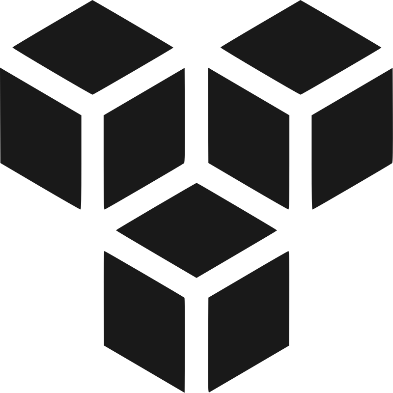
Voxelify
</h1>


## Overview
**Voxelify** is a lightweight JavaScript library for rapid 3D voxel modeling and rendering with the powerful *VoxelMesh* object.

## What's new in v2.0

Voxelify v2 targets **WebGPU**. The voxel shader was rewritten from GLSL
(`onBeforeCompile` injection) to **TSL** node materials, so it now requires
`THREE.WebGPURenderer` and three.js **r185+**.

- `VoxelMesh` materials are `VoxelMaterial`, which extends `MeshStandardNodeMaterial`
- the library imports from `three/webgpu` (not `three`)
- the classic `WebGLRenderer` is no longer supported — note that `WebGPURenderer`
  automatically falls back to WebGL2 when WebGPU is unavailable, so it runs everywhere

**Renamed in v2.0** — the modeling entry points now read as one vocabulary:
`createVoxelMesh()` is **`build()`**, matching `VoxelCompute.build()`;
`createFromPositions()` is the static **`VoxelMesh.fromPositions()`**, matching
`VoxelMesh.fromVoxelCompute()` and `VoxelCompute.fromVoxelMesh()`; and
`setAtlasTexture()` is **`setVoxelMaterial()`**, since it now sets the whole
material rather than just the atlas (below). The rule is:
**`build` is the verb, `from*` is a static factory.** `setVoxel`, `loadVOX` and
friends are unchanged.

**One way to set the material in v2.0** — `setVoxelMaterial()` takes **every**
material setting in one bag: `tileCount`, `map`, `normalMap`, and any
`MeshStandardMaterial` property. It can be called **before or after `build()`**,
and repeated calls accumulate. `build()` accepts the same bag, so
`VoxelMesh.setVoxelMaterial( params )`, `VoxelMesh.build( params )` and
`VoxelCompute.build( sdfFn, params )` all share one contract. **What you set is
what you get** — Voxelify derives no material defaults behind your back.

**New in v2.0** — `VoxelHeightField`, a `VoxelCompute` subclass for terrain that
**allocates no dense grid at all**. One thread per *(x, z)* column instead of one per
cell: 65,536 threads and 1.5 MB at 256&sup2;, against 16.7 million cells and 67 MB.
Feed it a height texture with `terrainFromImage()`, or compute the height in TSL and
rebuild the whole landscape every frame.

**Removed in v2.0** — the `.voxMap` Map is gone. Voxel data now lives in a compact
typed array (`.geometry.attributes.aVoxData`) plus an internal position&rarr;index
map, so `initVoxMap()`, `clearVoxMap()` and `regenVoxMap()` no longer exist. Build
voxels with `setVoxel()` / `VoxelMesh.fromPositions()` and edit them with
`addVoxels()` / `deleteVoxels()`.

## Installation
1. Run the following command to install voxelify via npm:
```sh
npm install voxelify three
```
2. Once installed, you can import it into your project:
```js
import { VoxelMesh } from 'voxelify'
```
3. Render with `WebGPURenderer`, and import three from the `three/webgpu` bundle.
   `three` and `three/webgpu` are separate bundles — mixing them breaks
   `instanceof` checks, so pick one and stay on it:
```js
import * as THREE from 'three/webgpu'

const renderer = new THREE.WebGPURenderer({ antialias: true })
await renderer.init() // WebGPURenderer needs async initialization
```
4. If you use addons (`three/examples/jsm/*`), point their internal `three` import
   at the WebGPU bundle in your bundler config:
```js
// vite.config.js
export default defineConfig({
  resolve: {
    alias: [ { find: /^three$/, replacement: 'three/webgpu' } ],
    dedupe: [ 'three' ],
  },
})
```
Now you’re ready to start using voxelify to create 3D voxel content!

## Basic Usage

#### Example 1: shows voxel generation from (x,y,z) points
```js
import { VoxelMesh } from 'voxelify'
import { TorusKnotGeometry } from 'three/webgpu'

const randomHexColor = () => {
    let r = Math.round( Math.random() * 0xff )
    let g = Math.round( Math.random() * 0xff )
    let b = Math.round( Math.random() * 0xff )
    return ( ( r << 16 ) | ( g << 8 ) | b )
}

let x,y,z,c,t
const geometry = new TorusKnotGeometry( 20, 20*0.3, 200, 32 )
const position = geometry.getAttribute( 'position' )

const voxMesh = new VoxelMesh()
for ( let i = 0; i < position.count; i++ ) {
    x = position.getX(i)
    y = position.getY(i)
    z = position.getZ(i)
    c = randomHexColor() // optional
    t = undefined        // optional
    voxMesh.setVoxel( x, y, z, [ c, t ] )
}
voxMesh.build()

scene.add( voxMesh ) // rendered by three.js
```

#### Example 2: shows voxel generation using atlas (texture map applied to each voxel)
```js
import { VoxelMesh } from 'voxelify'
import { MathUtils, TorusKnotGeometry } from 'three/webgpu'

let x,y,z
const positions = []
const colors = []
const tiles = []
const geometry = new TorusKnotGeometry( 20, 20*0.3, 200, 32 )
const position = geometry.getAttribute( 'position' )

for ( let i = 0; i < position.count; i++ ) {
    x = position.getX(i)
    y = position.getY(i)
    z = position.getZ(i)
    positions.push( x, y, z )
    colors.push( 0xffffff )                  // optional
    tiles.push( MathUtils.randInt( 0, 15 ) ) // optional
}

const voxMesh = VoxelMesh.fromPositions( positions, colors, tiles, {
    tileCount: { x: 16, y: 4 },              // the atlas is a 16 x 4 grid of tiles
    map: 'images/atlas/sampleAtlas.png',     // a URL or a Texture
} )

scene.add( voxMesh ) // rendered by three.js
```

#### Example 3: shows voxel rendering performance
```js
import { VoxelMesh } from 'voxelify'
import { Color, LinearSRGBColorSpace, MathUtils } from 'three/webgpu'

const positions = []
const colors = []
const tiles = []
const col = new Color()
const meshSize = 128
const numVoxels = 300000 // ~2.4M surface voxels hold 60 FPS on a GTX 1080 at 1920x1080

const linearRand = ( min, max ) => ( min + Math.random() * ( max - min ) )

const xyz_to_hexColor = ( x, y, z ) =>
{
    x = Math.sin( x*0.1 )*0.5 + 0.5
    y = Math.cos( y*0.1 )*0.5 + 0.5
    z = Math.sin( z*0.1 )*0.5 + 0.5
    const hue = x * y * z
    const hexCol = col.setHSL( hue, 1, 0.5 ).getHex( LinearSRGBColorSpace )
    return hexCol
}

for( let i = 0; i < numVoxels; i++ )
{
    const x = linearRand( -meshSize, meshSize )
    const y = linearRand( -meshSize, meshSize )
    const z = linearRand( -meshSize, meshSize )
    positions.push( x, y, z )

    const hexCol = xyz_to_hexColor( x, y, z )
    colors.push( hexCol )

    const tileId = MathUtils.randInt( 0, 15 ) // tileId of atlas texture
    tiles.push( tileId )
}

const material = {
    tileCount: { x: 16, y: 4 },
    map: 'images/atlas/sampleAtlas.png',
    roughness: 0.2,                       // any MeshStandardMaterial property
    emissive: new Color(0x191919),
}

const voxMesh = VoxelMesh.fromPositions( positions, colors, tiles, material )

scene.add( voxMesh ) // rendered by three.js
```

## VoxelMesh Class Structure

See the base [Mesh](https://threejs.org/docs/index.html?q=mesh#api/en/objects/Mesh) class for common properties.

| Constructor | Description |
| --- | --- |
| VoxelMesh() | Create a new VoxelMesh object |

| Properties | Type | Description |
| --- | --- | --- |
| .isVoxelMesh | Boolean | Read-only flag to check if a given object is of type VoxelMesh |
| .options | Object | Set the options for the generation <br> default options = { shelling: true /* kill the voxels inside */, ... } |
| .voxDim | Integer | Dimension of vox, if voxDim = 2, 3, 4, then we have vox = { vc }, { vc, vs }, { vc, vs, vr }, respectively |
| .voxType | String | Voxel type, which is one of '*cube*', '*box*', '*sphere*', '*sphere8*', '*cylinder*', '*tetrahedron*', '*octahedron*', or '*lego*' ('*sphere8*' is the cheaper 8-faced sphere) |
| .material | VoxelMaterial | The material, created by `build()`. Read it to inspect what is in effect; **write to it through `setVoxelMaterial()`** so `build()` can rebuild the same material later <br> *(the v2.0 `.atlas` property is gone — the atlas is now part of the material bag)* |

| Methods | Return | Description |
| --- | --- | --- |
| .setVoxelMaterial(params) | this | Set **everything about the material** in one bag. **What you pass is what you get** — nothing is derived behind your back. Call it **before or after `build()`**; repeated calls accumulate, so earlier settings survive: <br> params = { <br> &nbsp;&nbsp; tileCount: { x: 16, y: 4 }, &nbsp;&nbsp;// defaults to { x: 1, y: 3 } <br> &nbsp;&nbsp; map: 'myFolder/myDiffuse.png', &nbsp;&nbsp;// a URL string or a Texture <br> &nbsp;&nbsp; normalMap: 'myFolder/myNormal.png', <br> &nbsp;&nbsp; roughness: 0.2, &nbsp;&nbsp;// …and any other MeshStandardMaterial property <br> } <br> *tileCount* is how many tiles the atlas holds across and down — a 256&times;64 texture cut into 16&times;16 tiles is `{ x: 16, y: 4 }`. Counts, not pixels. A non-integer count means the texture does not divide evenly and the last tile is clipped — allowed, but it logs a warning <br> ⚠️ **Always route atlas textures through here.** This is where nearest filtering, mipmaps and color space are set; assigning straight to `material.map` skips all of it and the tiles bleed into each other <br> `voxType`, `voxDim` and `sizeScale` are rejected with a warning — the geometry owns those, not the material |
| .vp_to_xyz(vp) | Array | Get the voxel coordinate [x,y,z,w] from the *vp* (voxel position) |
| .xyz_to_vp(x, y, z, w=0) | Integer | Get the *vp* from (x,y,z,w). Coordinates are **rounded** and clamped to 0~255 |
| .getVoxelPos(p) | Integer | Get the *vp* of the cell containing the world point *p*. Coordinates are **floored**, not rounded — a voxel *vp* occupies the box [vp, vp+1] |
| .initVoxels() | undefined | Discard every voxel and reset this mesh to its empty state |
| .setVoxel(x, y, z, vox) | undefined | Add a voxel at (x,y,z) — coordinates are rounded to integers — where *vox* = [ hexCol, tileId, size, opacity, life, rotx, roty, rotz ]. Every entry after *hexCol* is optional, and only the prefixes of length 1, 2, 5 and 8 are read. *tileId* = 0~127, the rest = 0~255 <br> Duplicates are allowed here; the first one wins when the mesh is built |
| .getVoxel(x, y, z) | Object | Get the vox from (x,y,z), or *undefined* if there is no voxel there <br> **The returned vox is a copy** — modifying it does not change the mesh |
| .getVoxelCount() | Integer | Number of voxels currently in the mesh (0 before it is built) |
| .findVoxelPos(vp, offset) | Integer | Get the *vp* that is *offset* away from *vp*, where offset = (eg) '*pnz*' or [1,-1,0]. The voxel need not exist |
| .findVoxel(vp, offset) | Integer or null | Same as above, but returns *null* unless a voxel actually exists there |
| .findFaceNeighbors(vp) | Array | Find all voxels connected to 6 faces |
| .findEdgeNeighbors(vp) | Array | Find all voxels connected to 12 edges |
| .findVertexNeighbors(vp) | Array | Find all voxels connected to 8 vertices |
| .findAllNeighbors(vp) | Array | All 26 neighbors at once (faces + edges + vertices), de-duplicated |
| .deleteVoxels(vps) | undefined | Delete the voxels pointed to by vp array |
| .addVoxels(vdatas) | undefined | Add the voxels where vdatas = [ [vp,vox], ...] where vox = { vc, vs, vr } |
| .build(params) | undefined | Bake the voxels piled up by `setVoxel()` into geometry. **Call it once you are done adding voxels** — everything after that point (picking, editing, bounding boxes) needs it <br> *params* is optional and is **the same bag as `setVoxelMaterial()`**, so the material can be set right here: `voxMesh.build({ tileCount: { x: 16, y: 4 }, map: 'atlas.png', roughness: 0.2 })` <br> Calling it again with no arguments rebuilds the geometry and **keeps the material settings you already gave** — which is why `center()`, `simplify()` and `loadVOX()` do not lose them <br> Same verb as `VoxelCompute.build()`, but this class *is* the mesh, so it builds itself instead of returning one |
| .fillHoles() | undefined | Close pinholes left in a surface — for each voxel, if a pair of opposite edge-neighbors is missing along an axis, one is filled in with that voxel's color. Runs two passes, then rebuilds once. **Call it after `build()`**; voxels on the 0/255 boundary are skipped |
| .raycast(raycaster, intersects) | undefined | Get intersections between a casted ray and this object |
| .intersectRay(rayStart, rayEnd) | Object or null | Walk the voxel grid along a world-space ray (DDA) and return the first voxel hit |
| .setupEventListeners<br>(camera, domElement) | undefined | Attach pointer handlers for interactive voxel picking, adding and deleting |
| .getBoundingBox(space='local')| Box | Get the bounding box, where space is 'local' or 'world' |
| .getBoundingSphere(space='local')| Sphere | Get the bounding sphere, where space is 'local' or 'world' |
| .center() | undefined | Positions this object at the center of world coordinate system |
| .rotate(axis, theta) | undefined | Rotate *theta* angle about the *axis*  |
| .scaleDown(factor) | undefined | Shrink every voxel coordinate by *factor* and rebuild. Unlike `.simplify()` it does **not** scale the mesh back up |
| .simplify(factor) | undefined | Simplify by *factor* where 0 < *factor* < 1 |
| .world_to_local(p) | Vector3 | Convert the world point *p* into voxel space (0~255), in place |
| .local_to_world(p) | Vector3 | Convert the voxel-space point *p* into world space, in place |
| .rgbToHex(r, g, b) | Integer | Pack (r,g,b), each 0~1, into a hex color |
| .hexToRGB(hex) | Array | Unpack a hex color into [ r, g, b ], each 0~1 |
| .copy(source, recursive) | undefined | Copy the *source* into this object |
| .loadVOX(url) | Promise | Load from url pointing to a file in VOX format — `await` it, the fetch is asynchronous |
| .saveVOX(filename) | undefined | Save this object as VOX format |
| .toVoxelArray() | Object or null | The baked voxels as `{ data, count, voxDim, min, max }`, or *null* before the mesh is built. No copy is made — `data` **is** the mesh's own array, and `min`/`max` are in voxel space (0~255), not world space |

| Static Methods | Return | Description |
| --- | --- | --- |
| VoxelMesh.fromPositions<br>(positions, colors, tiles, material) | VoxelMesh | Build a new mesh from a point cloud — order does not matter and duplicates are fine, so a 3D scanner's output can be poured straight in. Already built, so add it to the scene directly. All inputs optional except positions: <br> - positions = [ px,py,pz, ... ]<br> - colors = [ hexCol, ... ]<br> - tiles = [ tileId, ... ] (*tileId = tile id of atlas texture)<br> - material = one bag holding **everything the material needs**: `tileCount`, `map`, `normalMap`, plus any `MeshStandardMaterial` property (`roughness`, `emissive`, `wireframe`, …) — the same bag `setVoxelMaterial()` takes, handed straight to `build()` |
| VoxelMesh.get_xyz(vp) | Array | Unpack a *vp* into [ x, y, z ], each 0~255 |
| VoxelMesh.get_vp(x, y, z) | Integer | Pack (x,y,z) into a *vp*. Unlike `.xyz_to_vp()` it neither rounds nor clamps — pass integers in range |
| VoxelMesh.get_col(vc) | Integer | Extract the 0xrrggbb color out of a *vc* (which also carries the tileId) |
| VoxelMesh.fromVoxelCompute<br>(vox, options) | Promise&lt;VoxelMesh&gt; |  Move voxels built on the GPU by `VoxelCompute` into a CPU-side `VoxelMesh`, so they can be edited, picked and transformed. **Pass the `VoxelCompute` instance**, not the `Mesh` its `build()` returned. Reads the whole voxel buffer back from the GPU, so keep it out of the render loop <br> `shelling` is forced off so the conversion copies rather than edits; pass `options` to override. If the source was built with `surfaceOnly`, its interior is already gone and ambient occlusion will differ from the original |

## VoxelCompute Class Structure

`VoxelCompute` is the v2.0 GPU path. Where `VoxelMesh` builds voxels one at a time
on the CPU, `VoxelCompute` evaluates a **signed distance function on the GPU** —
one thread per grid cell — and compacts the result straight into an instanced
buffer. Nothing is read back, so a 256&sup3; grid builds in milliseconds.

The scene function is plain TSL: it receives the normalized position `p0`
(&minus;1 ~ 1 on each axis) and returns a color, where **0 means empty**.

```js
import { VoxelCompute } from 'voxelify'
import { select, uint } from 'three/tsl'

const sphere = ( p0 ) => {
    const d = p0.length().sub( 0.8 )
    // a voxel wherever the surface passes through — color 0 means empty
    return { color: select( d.abs().lessThan( 0.01 ), uint( 0xff8844 ), uint( 0 ) ) }
}

const voxCompute = new VoxelCompute( renderer, {
    nx: 256, ny: 256, nz: 256,
    maxVoxels: 1_000_000, // required — 256³ cells would need 268 MB otherwise
    surfaceOnly: true,
    worldSize: 192,
} )

const mesh = await voxCompute.build( sphere )
scene.add( mesh ) // rendered by three.js
```

| Constructor | Description |
| --- | --- |
| VoxelCompute(renderer, options) | Create a GPU voxel builder bound to a `WebGPURenderer` |

| Options | Default | Description |
| --- | --- | --- |
| nx, ny, nz | 256 | Grid resolution on each axis |
| maxVoxels | nx&middot;ny&middot;nz | Cap on the compacted instance count. **Pass this** — the default allocates one slot per cell, which is 268 MB at 256&sup3;. Overflow is dropped, and shows up as `readVoxelCount()` exceeding `maxVoxels` |
| voxType | '*cube*' | Voxel shape, same set as `VoxelMesh` |
| surfaceOnly | false | Drop voxels whose 6 face neighbors are all filled. The silhouette is unchanged, but the voxel count falls sharply |
| worldSize | nx | Size the mesh occupies in world units. Fixing it makes the grid resolution a *quality* knob instead of a *size* knob |
| center | false | Anchor the mesh to the **voxel bounding box** center instead of the **grid** center, so a scene that fills only part of the grid still sits at the origin. Costs one voxel-buffer readback during `build()`; the center is then fixed, so `rebuild()` will not make the object drift |

| Properties | Type | Description |
| --- | --- | --- |
| .isVoxelCompute | Boolean | Read-only flag to check if a given object is of type VoxelCompute |
| .aVoxData | StorageInstancedBufferAttribute | Compacted voxel data, resident on the GPU |
| .mesh | Mesh or null | The most recent mesh `build()` produced, *null* before the first build. The only way to reach it when a call hands back the `VoxelCompute` rather than the mesh |
| .uTime | Node | Seconds uniform read by the kernel built by `setAnimation()` |

| Methods | Return | Description |
| --- | --- | --- |
| .build(sdfFn, params) | Promise&lt;Mesh&gt; | Run the fill &rarr; neighbor &rarr; compact passes and return a renderable `Mesh` <br> *params* is **the same material bag as `VoxelMesh.setVoxelMaterial()`** — `tileCount`, `map`, `normalMap`, plus any `MeshStandardMaterial` property. Textures get the same nearest-filter / color-space treatment <br> Called again, it reuses the geometry it already built (the compute buffers are shared, so a fresh one would have to be identical anyway) and disposes only the previous material |
| .rebuild(time) | undefined | Re-run those passes in place, for scenes whose voxel *set* changes over time. Queues without awaiting — **use this inside the render loop** |
| .rebuildAsync(time) | Promise | Same, but awaits GPU completion. Awaiting mid-frame can show an empty mesh, so keep it out of the render loop |
| .setAnimation(fn) | this | Install a per-frame kernel `fn( vox, ctx )` that rewrites `aVoxData` in place. Use when the voxel *set* is fixed and only its attributes move — no readback, no rebuild |
| .prepareAnimationAsync() | Promise | Snapshot the current `aVoxData` as the initial state that `setAnimation()` interpolates from |
| .update(time) | undefined | Run one animation frame. Queues without awaiting, like `rebuild()` |
| .updateAsync(time) | Promise | Same, but awaits GPU completion |
| .readVoxelCount() | Promise&lt;Integer&gt; | Read the voxel count back from the GPU. **Diagnostic only** — drawing reads the same value on the GPU via indirect draw |
| .readVoxels() | Promise&lt;{data, count}&gt; | Read the compacted voxels back to the CPU, trimmed to the part actually filled (an overflowing scene is clamped to `maxVoxels`). **The transfer is sized by `maxVoxels`, not by the voxel count** — over-provisioning it costs time here. Keep this out of the render loop |

| Static Methods | Return | Description |
| --- | --- | --- |
| VoxelCompute.fromVoxelMesh<br>(renderer, voxMesh, options) | Promise&lt;VoxelCompute&gt; | Upload an authored `VoxelMesh` into a new pipeline instead of evaluating a scene function, so it can then be animated with `setAnimation()`. The renderable mesh is `.mesh`. Every per-voxel field carries over, `vs` and `vr` included <br> `options` takes the constructor options — omit the grid and `maxVoxels` and they are sized from the mesh. `options.material` is the odd one out: it goes to the material, not the constructor |

## VoxelHeightField Class Structure

`VoxelHeightField` **extends `VoxelCompute`** and drops the dense grid entirely.

A height field does not need one. Every voxel in a column *(x, z)* follows from a
single height, and neighbor relations follow from the neighboring columns' heights.
So the thread count is the **column** count, not the cell count, and the only buffers
are a few words per column:

|  | VoxelCompute (dense) | VoxelHeightField (columns) |
| --- | --- | --- |
| Threads at 256&sup3; / 256&sup2; | 16,777,216 cells | **65,536 columns** |
| Working memory | 67 MB | **1.5 MB** |
| Passes | fill &rarr; compact | column &rarr; lowest-neighbor &rarr; emit |

Rendering is untouched — the same `aVoxData` / `aVoxNB` buffers, geometry and material
as `VoxelCompute`, so everything in that section still applies.

```js
import { VoxelHeightField, terrainFromImage } from 'voxelify'

const voxHeight = new VoxelHeightField( renderer, {
    nx: 256, ny: 128, nz: 256,
    maxVoxels: 400_000,
    worldSize: 192,
    center: true,
} )

const mesh = await voxHeight.build( await terrainFromImage( 'heightmap.png', {
    heightScale: 0.5,
    colorMap: 'diffuse.png',
    cliff: 0x8b5a2b,
    seaLevel: 8,
} ) )

scene.add( mesh )
```

### The scene contract

`build()` takes a **column scene** instead of an SDF — an object, not a function:

```js
const scene = {
    isHeightField: true,
    column: ( x, z, ctx ) => ( { height, color, cliff } ),
}
```

| Field | Description |
| --- | --- |
| x, z | Grid coordinates, `uint` nodes |
| ctx | `{ time, nx, ny, nz }` — `time` is the `uTime` uniform, the rest are plain numbers |
| height | Float node. ⚠️ **Do not round it.** The class rounds for the column top but compares neighbors *unrounded*, which is what shapes the cliffs |
| color | Voxel color at the top of the column. **0 leaves the column empty** |
| cliff | Color of the wall filling the drop to the lowest neighbor. **0 builds no wall** — this is how water is expressed, with no special case |

Because `column()` is evaluated on the GPU, a scene can be **rebuilt every frame** —
something the dense path cannot afford and a texture cannot express, since the CPU
would have to re-bake and re-upload the image each frame.

```js
// waves that move: height is computed in the kernel, not read from an image
renderer.setAnimationLoop( ( t ) => voxHeight.rebuild( t / 1000 ) )
```

| Methods | Return | Description |
| --- | --- | --- |
| .build(scene, params) | Promise&lt;Mesh&gt; | Same contract as `VoxelCompute.build()`, including the material bag. Rejects a scene without `isHeightField` |

Everything else — `rebuild()`, `readVoxelCount()`, `readVoxels()`, the constructor
options — is inherited unchanged.

> ⚠️ **This path produces a surface only** — the column top plus the cliff below it.
> Solid interiors need the dense path.

> ⚠️ **Grids are capped at 256 per axis and heights at 255**, because `vp` packs the
> coordinate into 8 bits per axis. Larger terrain has to be split into chunks.

> ⚠️ One value per column means **no overhangs, caves, or trees**. Author those with
> `VoxelMesh` (see `createVoxelTerrains`) and add them as a separate mesh.

## VoxelMesh vs VoxelCompute

The two classes write the same buffers and render through the same material, but
they are not the same kind of object. **`VoxelMesh` is something you hold and edit;
`VoxelCompute` is a factory that stamps voxels out.**

|  | VoxelMesh | VoxelCompute |
| --- | --- | --- |
| What it is | `extends Mesh` — a scene-graph object in its own right | A builder. `build()` returns a **plain `Mesh`** with none of these methods on it |
| Source of truth | CPU — a typed array plus a position&rarr;index map | GPU storage buffers. **No CPU copy exists** |
| Cost model | *Sparse* — scales with the **voxel count** (8~16 B each) | *Dense* — scales with the **cell count** (4 B per cell, so 67 MB at 256&sup3; no matter how few voxels come out). `VoxelHeightField` is the way out when the shape is a height field |
| Authoring | Imperative: `setVoxel()` + `build()`, `addVoxels()`, `loadVOX()`, `VoxelMesh.fromPositions()` | Declarative: one TSL function evaluated once per cell. Plain JS scene functions will not work |
| Editing & queries | `getVoxel()`, `findVoxel()`, `findAllNeighbors()`, `deleteVoxels()` | **None.** A single voxel cannot be read from the CPU |
| Picking & input | `intersectRay()`, `raycast()`, `setupEventListeners()` | **None** |
| Transforms | `center()`, `rotate()`, `scaleDown()`, `simplify()`, `getBoundingBox()` | **None.** The returned mesh is anchored to the **grid** center, so an object filling only part of the grid stays off-center — pass `center: true` to anchor it to the voxel bounding box instead |
| Animation | Rebake geometry on the CPU each frame | GPU-resident: `rebuild()` / `setAnimation()` rewrite the buffers in place, with no readback and no rebake |
| Grid size | Does not affect memory | Drives memory directly; passing `maxVoxels` is effectively mandatory |

### Choosing between them

- Voxels a **user touches** — an editor, click-to-place, delete-on-click &rarr; **`VoxelMesh`**
- Voxels **generated procedurally** — SDFs, fractals, particles, millions at
  a time, or rewritten every frame &rarr; **`VoxelCompute`**
- Voxels that are a **height field** — terrain, landscapes, anything with one surface
  per *(x, z)* &rarr; **`VoxelHeightField`**, which skips the dense grid entirely

### What they share

Both build an `InstancedBufferGeometry` drawn by `VoxelMaterial`, and both use the
same `aVoxData` / `aVoxNB` layout, so the rendering path is identical. `VOXExporter`
accepts either one — see *Exporting to .vox* below.

### Crossing between them

Both directions exist, and a round trip is **lossless** — position, color, tile id,
`vs` (size, opacity, life) and `vr` (rotation) all survive.

```js
// GPU -> CPU: make a generated scene editable and pickable
const mesh = await VoxelMesh.fromVoxelCompute( voxCompute )

// CPU -> GPU: give an authored model GPU-resident animation
const voxCompute = await VoxelCompute.fromVoxelMesh( renderer, voxMesh )

scene.add( voxCompute.mesh )
voxCompute.setAnimation( fn )
```

Left alone, `fromVoxelMesh()` sizes the grid to the mesh's bounding box, which matters
because the dense buffers scale with the grid: a model living inside 0~63 costs a
64&sup3; grid rather than a 256&sup3; one. Pass any constructor option to override —
plus `material`, which is forwarded to the material rather than the constructor:

```js
const voxCompute = await VoxelCompute.fromVoxelMesh( renderer, voxMesh, {
    nx: 64, ny: 64, nz: 64,
    center: true,
    material: { roughness: 0.25 },
} )
```

> ⚠️ Either direction is a one-time step, not something for the render loop. Going
> CPU &rarr; GPU also trades a sparse layout for a dense one, so it costs grid-sized
> memory no matter how few voxels there are.

## Exporting to .vox

`VOXExporter.saveAsync()` accepts **both** paths, so new code can call it without
knowing where the voxels came from:

```js
import { VOXExporter } from 'voxelify'

await new VOXExporter().saveAsync( voxMesh,    'cpu.vox' ) // VoxelMesh
await new VOXExporter().saveAsync( voxCompute, 'gpu.vox' ) // VoxelCompute
```

| Methods | Return | Description |
| --- | --- | --- |
| .saveAsync(source, filename) | Promise | Save a `VoxelMesh` or a `VoxelCompute` as VOX format |
| .save(object, filename) | undefined | Synchronous, `VoxelMesh` only. Kept for v1 compatibility — prefer `saveAsync()` |

> ⚠️ For the GPU path, pass the **`VoxelCompute` instance**, not the `Mesh` that
> `build()` returned. Its `aVoxData` is GPU storage, so reading it back needs the
> renderer and the voxel count — both of which live on the instance.

## Scene & Helper Modules

Everything below is exported from the package root. Most of it produces **scene
functions** for `VoxelCompute.build()`. Two exceptions: `VoxelTerrain` runs on the CPU
and fills a `VoxelMesh`, and `terrainFromImage()` returns a **column scene** for
`VoxelHeightField.build()` rather than a scene function.

A scene function receives the normalized cell position `p0` (&minus;1 ~ 1 on each
axis) and returns one of two shapes:

- `{ dist, color }` — a **solid**: the cell is filled where `dist < 0`. A color of 0
  would be indistinguishable from an empty cell, so it is nudged up to 1
- `{ color }`, or a bare color node — **the color itself is the occupancy**, filled
  wherever `color > 0`. No distance test runs

The fractal and raymarch scenes use the second form: `distToColor()` has already
zeroed everything outside the shell, so there is no distance left to report.

### VoxelSDF — TSL building blocks

The vocabulary the other scene modules are written in. Use it to write your own.

| Group | Exports |
| --- | --- |
| Primitives | `sdPlane` `sdSphere` `sdBox` `sdRoundBox` `sdBoxFrame` `sdEllipsoid` `sdTorus` `sdCylinder` (= `sdCappedCylinder`) `sdCylinderX/Y/Z` `sdRoundCone` `sdCapsule` |
| Operators | `opUnion` `opSubtract` `opIntersect` `opSmoothUnion` `opUnionStairs` `opRepeat` `opRepeatScalar` `opRound` `opOnion` |
| Color | `rgbToHex` `hsvToRgb` `hsvToHex` `rgb255ToHex` `paletteColor(t, pal)` `trapToColor(trap, colType)` `distToColor(dist, eps, trap, colType)` |
| Transforms | `rotateX` `rotateY` `rotateZ` (aliases `rotate_x/y/z`), `vmat2` `vmat3` |
| Grid & math | `indexToIJK` `ijkToPosition` `uintToVec4` `glslMod` `jsMod` `vmod` `vfract` `vround` `hashU32` `rand(seed, k)` `texture2D` |

> ⚠️ `glslMod` is floored, `jsMod` is truncated. They differ for negative inputs, and
> TSL's own `.mod()` is the floored one — pick deliberately.

> ⚠️ There is no randomness on the GPU here: `rand( pid, k )` is a **hash** of the
> particle id, so a scene renders identically every run. The draw order `k = 0, 1, 2 …`
> is part of the result — reordering the calls changes the output.

### VoxelFractals — distance-estimated fractals

Fifteen scene functions, all `( p0 )` unless noted, all returning `{ color }`.

`mandelbulb` `juliabulb` `mandelbox(p, {iterations = 10})` `mengerSponge`
`recursiveTetrahedron` `apollonian(p0, {iterations = 8})` `hexTiling`
`ellybulb(p0, {eps = 0.01})` `alteredMenger` `remnant` `pillarCave`
`sierpinskiTetrahedron` `sierpinskiOctahedron` `sierpinskiIcosahedron`
`sierpinskiDodecahedron`

> ⚠️ Fractals are reproducible but precision-sensitive. The shader is float32, each
> iteration amplifies error, and the result is then cut by a shell only ~0.001 thick —
> so voxels right at the shell boundary can flip. Smooth distance fields do not behave
> this way.

### VoxelRaymarch — hand-built distance fields

Eight scenes assembled from the `VoxelSDF` primitives and operators. Unlike the
fractals these are plain distance fields, so there is no iterative error to amplify
and they are insensitive to precision.

| Scene | Signature | Notes |
| --- | --- | --- |
| `primitives` | ( p0 ) | Nine SDF primitives laid out in a row |
| `operations` | ( p0, which = '*repeat*' ) | `'repeat'` &vert; `'round'` &vert; `'onion'` |
| `mengerSpongeScene` | ( p0 ) | Boxes subtracted repeatedly — a **different kernel** from `VoxelFractals.mengerSponge`, which is the IFS one. This one comes out solid, because occupancy is the signed `minDist < 0.001` rather than an absolute value |
| `sphereGrids` | ( p0 ) | A lattice of spheres carved out of a larger one |
| `colosseum` | ( p0 ) | |
| `monsterFace` | ( p0 ) | |
| `banquetHall` | ( p0 ) | Infinite hall — floor tiles, pillars, arched ceiling |
| `bigTree` | ( p0, treeType = 4, coloring = 7 ) | `treeType` 0~4, `coloring` 0~7. Both are **plain JS numbers**, so branching on them happens while the node graph is built and never reaches the shader |

> ⚠️ **These scenes want `n` = 256.** Occupancy is a shell `|dist| < 0.5` while the
> coordinates are scaled by 127, so the cell spacing is 254/n. At n = 256 the shell is
> just thick enough to cover one cell; drop below that and the surface develops holes.

> ⚠️ `monsterFace`, `banquetHall` and `bigTree` put the SDF origin at the **bottom** of
> the grid, so they fill only its lower part. Pass `center: true` to `VoxelCompute` to
> pull them back to the middle. Do not try to fix it by removing the offset — all three
> are mirror-symmetric about that plane, so the grid floor is acting as a clipping
> plane and removing it doubles the object instead of moving it.

### VoxelImages — voxels from a picture

These are not scene functions but **functions that build one**, because they need an
image as well as a position. They are `async`; the scene they return is not.

```js
import { VoxelCompute, cylinderFromImage, heightFromImage } from 'voxelify'

await voxCompute.build( await cylinderFromImage( 'images/voxels/elly.png' ) )
await voxCompute.build( await heightFromImage( 'a.png', 'a_displacementMap.png' ) )
```

| Function | Description |
| --- | --- |
| .cylinderFromImage(source) | Wraps the image onto a cylindrical shell |
| .heightFromImage(colorSource, heightSource) | A height field, displaced by the red channel of the second image |
| .terrainFromImage(heightSource, options) | Terrain from a height texture. ⚠️ **For `VoxelHeightField`, not `VoxelCompute`** |
| .resolveTexBuffer(source) | Normalizes any accepted input into a texture buffer handle |

#### terrainFromImage

`heightFromImage` above walks the dense grid asking *"is my z the height here?"*.
`terrainFromImage` builds a **column scene** instead, so it runs one thread per column
and never allocates a grid — see *VoxelHeightField Class Structure*.

```js
import { VoxelHeightField, terrainFromImage } from 'voxelify'

await voxHeight.build( await terrainFromImage( 'heightmap.png', {
    heightScale: 0.5,
    colorMap: 'diffuse.png',
    seaLevel: 8,
} ) )
```

| Option | Default | Description |
| --- | --- | --- |
| heightScale | 0.2 | Multiplies the red channel (0~255), so the default reaches height 51 |
| color | 0x8fbc5a | Flat top color, ignored when `colorMap` is given |
| colorMap | — | Image the top color is sampled from, on the same grid mapping |
| cliff | 0x8b5a2b | Color of the wall down to the lowest neighbor. **0 builds no wall** |
| seaLevel | null | Heights at or below this read as water: flattened to the level, colored `seaColor`, and given **no cliff** |
| seaColor | 0x2f6fbf | Water color |

The grid and the image need not match — texels are sampled proportionally, so a 512&sup2;
image drives a 256&sup2; grid without extra work.

`source` may be a URL string, a `THREE.Texture` (from either `load()` or
`loadAsync()`), an `HTMLImageElement` / `ImageBitmap` / `HTMLCanvasElement`, or a
handle `createTexBuffer()` already returned. Building several scenes from one image is
cheaper if you make the handle yourself and reuse it — otherwise the pixels are
re-extracted and re-uploaded on every call.

> ⚠️ Occupancy is the color, so a **black texel (hex 0) produces no voxel** even where
> the shell passes through.

> ⚠️ `cylinderFromImage` takes (u,v) from the grid coordinates, so the texture is
> projected along xy rather than wrapped around the cylinder.

### VoxelParticles — scatter scenes

Gather scenes ask *"what is at my cell?"*; scatter scenes compute *where a particle
lands*. A scatter scene is an object — `{ isScatter: true, count, emit( pid, ctx ) }` —
not a position&rarr;color function, and `build()` switches pipelines on that flag.

```js
import { VoxelCompute, galaxy } from 'voxelify'

const mesh = await voxCompute.build( galaxy( { branches: 6, spin: 3 } ) )
```

| galaxy(options) | Default | Description |
| --- | --- | --- |
| count | grid-derived | Particle count; a number, or `( voxCompute ) => number` |
| radius | 85.33 | How far the spiral reaches, in voxels |
| starRadius | 128 | Edge of the cube the background stars scatter through |
| starChance | 0.06 | Probability a particle becomes a background star |
| branches | 8 | Number of spiral arms |
| spin | 2 | How tightly the arms wind |
| power | 5 | Higher makes the arms thinner |
| thickness | radius / 10 | Maximum spread away from an arm |
| insideColor / outsideColor | — | `[ r, g, b ]`, each 0~1 |

> ⚠️ **Needs `n` &ge; 192.** The coordinates are fixed in voxel units (&plusmn;93.9)
> rather than scaled to the grid, so the galaxy is clipped on a smaller grid. Pass
> `radius` to fit it to the grid instead.

### VoxelWater — stateful water simulation

`waterWave( renderer, options )` bakes a terrain and a water column, then advances a
height field one step at a time. Unlike `VoxelMotion`, this one **carries state**:
skipping a step changes everything after it.

```js
const sim = waterWave( renderer )

await voxTerrain.build( sim.terrainScene )   // static,  voxType 'cube'
await voxWater.build( sim.waterScene )       // animated, voxType 'sphere'

sim.waterScene.update( t )   // = sim.step()
voxWater.rebuild( t )
```

| Returns | Description |
| --- | --- |
| nx, ny, nz | Grid size. `ny` is **computed** from the terrain peak plus the water height — pass it straight to `VoxelCompute` |
| terrainScene / waterScene | The two scenes; only the second one changes |
| terrainVoxels | Terrain voxel count, counted while baking — useful for `maxVoxels` |
| step() / stepAsync() | Advance one step |

| Options | Default | Description |
| --- | --- | --- |
| nx, nz | 64 | Footprint of the simulation |
| ny | computed | Grid height; override only if you know better |
| noiseScale / hueNoise | 3 | Terrain height and terrain color noise |
| friction | 0.115 | 0.115 gives large waves, 0.125 small ones |
| waterWidth / waterHeight | nx/4, nx/2 | The column of water dropped in at the start |

### VoxelAutomata — 3D cellular automata

`cellularAutomata( renderer, options )`. Also stateful, but its state is **integer**,
so unlike the water it stays exact no matter how many steps run.

```js
const sim = cellularAutomata( renderer, { preset: 'sang' } )
const voxCompute = new VoxelCompute( renderer, { nx: sim.n, ny: sim.n, nz: sim.n } )

await voxCompute.build( sim.scene )

if ( sim.scene.update() ) voxCompute.rebuild()  // update() stops itself at `iters`
```

| Options | Default | Description |
| --- | --- | --- |
| preset | '*sang*' | Key into `AUTOMATA_PRESETS` |
| rule, iters, coloring, seed | from preset | Override individual preset fields |
| n | derived | Grid size; derived from `iters` and the seed radius when omitted |
| rngSeed | 1 | PRNG seed for the `rand*` seed shapes, so they stay reproducible |

Returned: `n` `iters` `rule` `coloring` `scene` `step()` `stepAsync()` `reset()`
`checkAliveAsync()` `done` `finished` `dead` `maxLife`.

Rules are written `alive/birth/states/neighborhood`, where the neighborhood is `M`
(Moore, 26) or `N` (Von&nbsp;Neumann, 6) — `parseRules()` is exported if you want to
read one yourself. Presets: `crystal1` `crystal2` `vonNeumann` `diamond` `pulseWaves`
`baby` `elly` `mother` `jamie` `janice` `sang`.

> ⚠️ Grid size grows with `iters`, and `aVoxData` costs 16 B per slot. A 256&sup3;
> grid asks for 268 MB, past WebGPU's default 128 MiB binding limit — cap `maxVoxels`
> well below the cell count. These shapes are shells, so a few percent is plenty.

### VoxelMotion — GPU-resident animation

Time-varying scenes whose kernels are **stateless**: every frame recomputes
*initial state &rarr; now*, so skipping frames or rewinding time changes nothing.

| Scene | How it moves | Driven by | Cost scales with |
| --- | --- | --- | --- |
| `particleMotion01({ startTime, duration })` | The voxel set is fixed; each voxel travels between grid points carrying its own color, size and rotation | `setAnimation()` + `update()`, 1 pass | Voxel count |
| `fieldMotion01()` `fieldMotion02()` | Voxels never move; the field is re-evaluated so *which cells are lit* changes | `rebuild()`, 4 passes | Cell count, regardless of voxel count |

Also exported: `vec4ToUint` `normalizeTime( startTime, curTime, duration )`
`easeLinear` `hslToRgb`.

> ⚠️ The stateful simulations live elsewhere — `waterWave` in `VoxelWater`,
> `cellularAutomata` in `VoxelAutomata`. They are called the same way
> (`scene.update()` &rarr; `voxCompute.rebuild()`) but the guarantee above does not hold.

### VoxelTerrain — procedural terrain, on the CPU

The one module here that does not touch `VoxelCompute`. It bakes a grid of
`VoxelMesh` chunks and plants trees on them.

```js
import { createVoxelTerrains, TerrainDB } from 'voxelify'

const terrains = createVoxelTerrains( {
    selectTerrain: 2,   // terrain class, 0 ~ 6
    radius: 1,          // ( radius * 2 )² meshes are produced
    atlas: {
        tileCount: { x: 10, y: 3 },   // 160x48 texture, 16x16 tiles
        map: 'images/atlas/terrainAtlas.png',
        normalMap: 'images/atlas/terrainAtlasN.png',
    },
} )
```

`TerrainDB` holds the level, color and tile-id constants the seven terrain classes
share: elevation&plus;moisture, blended mountains, rocky, sand, grass with plateaus,
moon with craters, and a biome-selecting world.

Numeric helpers used by the terrain but generally useful — `SNoise` `clamp`
`smoothstep` `diskRand` `tex2heights` `tex2pixels` `cpuColor` — are exported from
`VoxelUtils`.

> ⚠️ This module is the **CPU** path, and the only one that plants trees. For terrain
> built on the GPU see `VoxelHeightField` — far cheaper and animatable, but one surface
> per column, so no trees, caves or overhangs.

## Voxel Representation & Features

- **Voxel record**: **8 to 16 bytes per voxel**, held in one flat `Uint32Array`
  (`.geometry.attributes.aVoxData`). How many of the four uints are live is `.voxDim`:

    | uint | packs | present when |
    | --- | --- | --- |
    | *vp* | w, z, y, x — each 0~255 | always |
    | *vc* | tileId, r, g, b — full color, no palette | always |
    | *vs* | null, life, opacity, size | `voxDim` &ge; 3 |
    | *vr* | null, rotz, roty, rotx | `voxDim` &ge; 4 |

  A cube voxel carries **4 more bytes** for `aVoxNB`, the 26-neighbor presence bitmask
  that drives ambient occlusion.
- **No chunks**: voxels are stored sparsely, so a `VoxelMesh` costs what it holds rather
  than a 32&times;32&times;32 block per region. `VoxelCompute` is the opposite by design —
  its grid is dense (4 bytes per *cell*), which is what buys the GPU build.
  `VoxelHeightField` needs no grid at all, at the cost of one surface per column.
- **1D keys, not 3D indexing**: a position is packed into a single integer with shifts
  and XOR (`get_vp`), so lookups avoid the multiplies a 3-axis index needs.
- **Rendering performance** — measured on a GTX 1080 with WebGPU timestamp queries,
  at 1920&times;1080 with the object filling the frame:

    | voxels | GPU frame time | ceiling |
    | --- | --- | --- |
    | 260,000 | 8.1 ms | 123 FPS |
    | 960,000 (surface) | 9.5 ms | 105 FPS |
    | 1,800,000 (surface) | 14.3 ms | 70 FPS |
    | **2,210,000 (surface)** | **14.8 ms** | **67 FPS** |
    | 2,680,000 (surface) | 19.5 ms | 51 FPS |
    | 6,030,000 (solid) | 55.6 ms | 18 FPS |

  So roughly **2.4M surface voxels** is where 60 FPS runs out on that GPU. Repeating a case
  lands within ~3%, but a whole session can sit ~10% off another, so read these as a shape,
  not a spec.

  Past ~2M the cost is **per-instance, not per-pixel** — shrinking the viewport to
  320&times;180 still leaves 6M voxels at 27.6 ms. Use `shelling` (CPU) or `surfaceOnly`
  (GPU) to keep the count down: a solid volume still pays the **per-instance geometry
  cost** for interior voxels — the depth test throws their pixels away, but their vertices
  are transformed and rasterized first.

<div style='text-align: center'>
    <a href='https://youtu.be/X9dkxjxfKK4?si=XWhnkIxlkJYFpnq-'>
        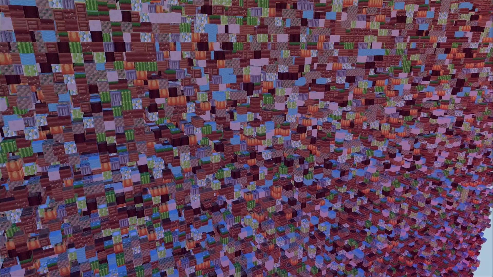
    </a>
    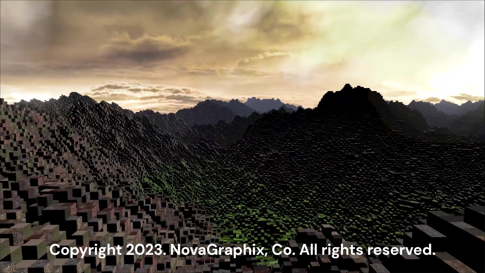
</div>

## Voxel Modeling & Processing

- **Element types** — `.voxType` selects one of **eight** instanced geometries, shared by
  both classes: `cube`, `box`, `sphere`, `sphere8` (cheaper 8-faced sphere), `cylinder`,
  `tetrahedron`, `octahedron`, `lego`. The shape is fixed per mesh; what varies per voxel
  is a **single scale** (`vs.size`) and, at `voxDim` 4, a rotation. Ambient occlusion and
  the neighbor bitmask are `cube`-only.
- **Lookup** — `getVoxel(x,y,z)` reads a voxel, `findVoxelPos(vp, offset)` walks to an
  offset such as `'pnz'` or `[1,-1,0]`, and `findVoxel(vp, offset)` returns it only if one
  is actually there.
- **Topology** — `findFaceNeighbors` (6), `findEdgeNeighbors` (12), `findVertexNeighbors`
  (8), or `findAllNeighbors` for all 26 at once.
- **Transforms** — `center()`, `rotate(axis, theta)`, and two different ways to shrink:
  `scaleDown(factor)` divides the coordinates, while `simplify(factor)` divides them and
  scales the mesh back up, so the object keeps its size with fewer voxels.
- **Ray intersection** — `intersectRay()` walks the grid (DDA) and `raycast()` plugs into
  three.js picking, so voxels can be selected with a mouse or touch.
- **Creating from point cloud** — `VoxelMesh.fromPositions()` takes an unordered point set
  and tolerates duplicates, so a 3D scanner's output can be poured straight in.
- **Shelling** — `options.shelling` (on by default) drops voxels whose 6 face neighbors are
  all present, since they can never be seen.
- **Filling** — `fillHoles()` closes pinholes in a surface, restoring voxels lost in the
  middle of it. Call it after `build()`.
- **Editing** — pick with the ray, then `addVoxels()` / `deleteVoxels()` patch the buffers
  in place instead of rebaking. `setupEventListeners(camera, domElement)` wires the whole
  loop up interactively. Click the [link](https://youtu.be/R2ihW7gPpIw?si=WWpkmm8UTKhb0Mbp) to watch the YouTube demo.
- **VOX format** — `loadVOX()` / `saveVOX()`, and `VOXExporter` also accepts a
  `VoxelCompute`. See *Exporting to .vox*.

<div style='text-align: center'>
    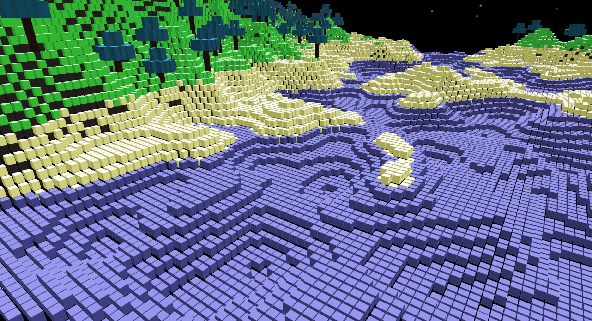
    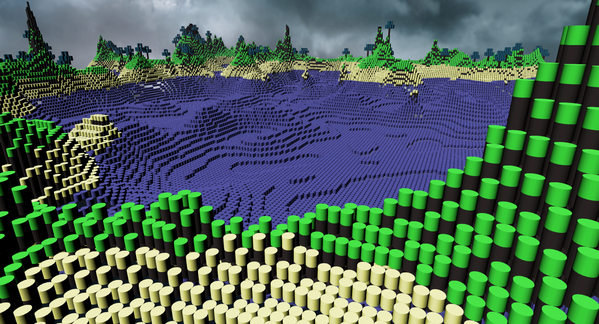
    
    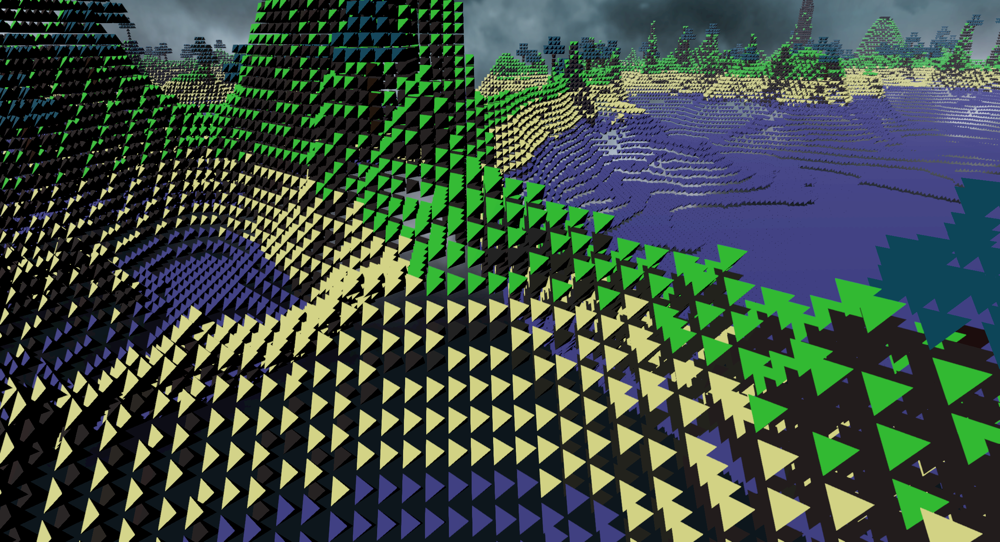
    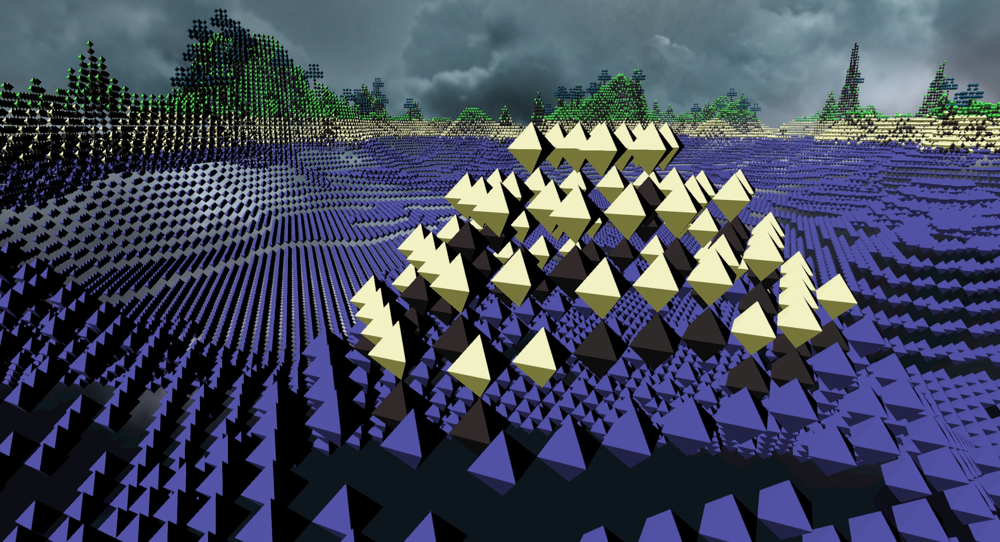
    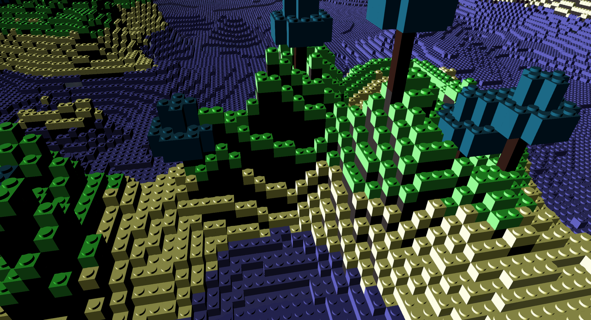
</div>

## PBR-based Voxel Rendering

- **PBR materials**: `VoxelMaterial` extends `MeshStandardNodeMaterial`, so voxels light
  like any other three.js PBR surface — `roughness`, `metalness`, `emissive` and the rest
  all apply.
- **Atlas texture**: one texture cut into tiles, with the per-voxel *tileId* choosing which
  tile a voxel wears. Route it through `setVoxelMaterial()` so nearest filtering, mipmaps
  and color space are set — the same bag also carries `roughness`, `emissive` and the rest,
  and `build()` / `VoxelMesh.fromPositions()` / `VoxelCompute.build()` all accept it.
- **Ambient occlusion**: the shader darkens each vertex from the 26-neighbor bitmask
  (`aVoxNB`), computed in the **vertex** stage so the gradient interpolates across a face.
  `cube` only.
- **Hidden-voxel removal**: interior voxels are dropped at build time — `shelling` on the
  CPU, `surfaceOnly` on the GPU. This is a build-time decision, not view-dependent culling.
- ⚠️ **No frustum or occlusion culling.** `frustumCulled` is deliberately set to `false`:
  every voxel lives in one instanced draw call, so three.js cannot cull them individually,
  and culling the mesh as a whole would only pop the entire object. Keep the voxel count
  down instead — see the numbers above.

<div style='text-align: center'>
    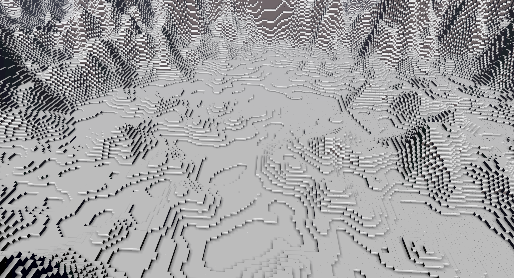
    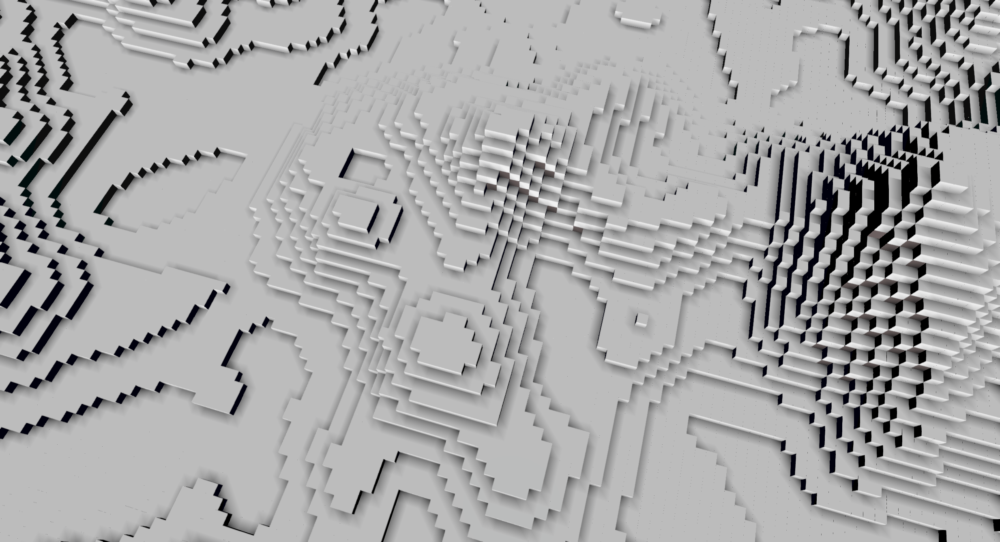
</div>

## Voxel Dynamics & Simulation

Everything here runs on **`VoxelCompute`**, the GPU path — see
[VoxelMesh vs VoxelCompute](#voxelmesh-vs-voxelcompute). `VoxelMesh` is the CPU class you
author and edit; it has no compute kernels of its own.

- **GPU computation**: `VoxelCompute` runs **one thread per grid cell**, evaluating the
  same TSL kernel everywhere at once and compacting the hits straight into the instanced
  buffer. Nothing is read back, so a 256&sup3; grid builds in milliseconds.
- **Signed distance functions**: an SDF renders directly — no marching cubes. A cell is
  filled when the field says so, which means SDF operators (union, subtraction,
  smooth-min, domain repetition) carry over unchanged. See `VoxelSDF` and `VoxelFractals`.
- **Animation properties**: four per-voxel fields drive animation — **size**, **opacity**,
  **life** and **rotation** (3 axes). They occupy the `vs` and `vr` uints, **8 bytes**
  total, and only exist at `voxDim` 3 and 4. A voxel whose *life* reaches 0 is discarded
  in the shader. `setAnimation()` rewrites them on the GPU with no readback and no rebake.
- **Scatter and particles**: besides the one-thread-per-cell grid path, `VoxelCompute` has
  a **scatter** path where a thread *is* a particle and computes where it lands. That is
  what `VoxelParticles` uses, and the same path is how `VoxelCompute.fromVoxelMesh()`
  uploads an authored mesh.
- **Water**: `VoxelWater` is a **height-field** simulation — water is moved between
  columns. It is deliberately not FLIP, SPH or a full Euler solver: there is no 3D
  velocity field and no pressure solve, which is what keeps it real-time on a large grid.
- **Cellular automata**: `VoxelAutomata` steps 3D CA rules (Moore-26 or Von&nbsp;Neumann-6
  neighborhoods) entirely on the GPU, for the rule families studied in physics,
  theoretical biology and microstructure modeling.

<div style='text-align: center'>
    <a href='https://youtu.be/pKaeW6yIXPo?si=z4BrcyO1gqQ6-eCq'>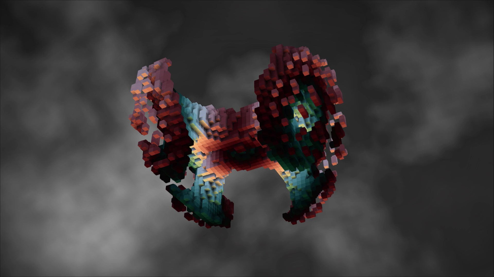</a>
    <a href='https://youtu.be/0g30rf1Z6oQ?si=Q5fwM8BwErYLNfJ-'>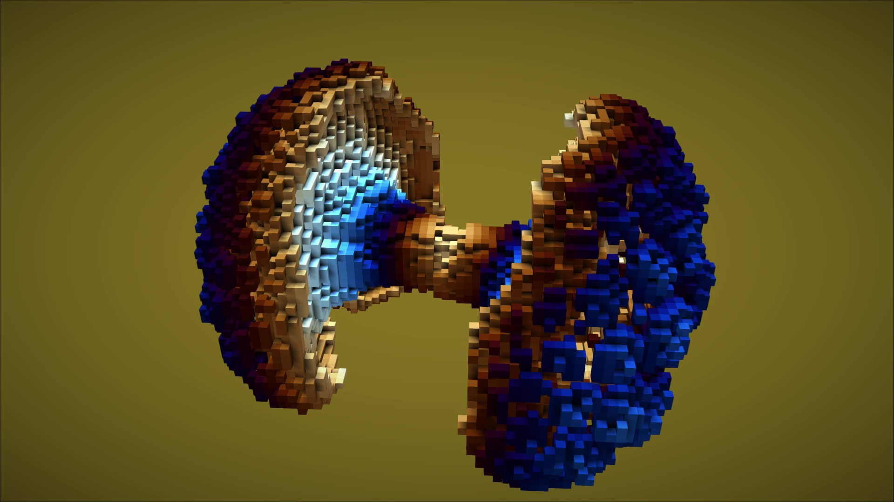</a>
    <a href='https://youtu.be/JAc7Sj1OHK0?si=Y_TEPWzsZkg6sqCv'>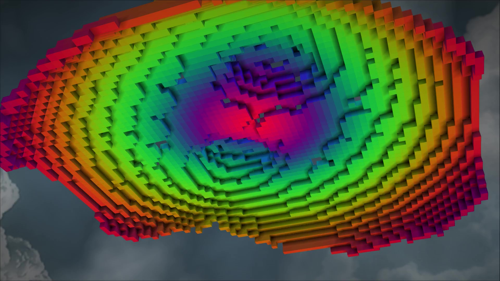</a>
    <a href='https://youtu.be/oX7mKh5quL8?si=hOzwuklynH34GdZx'>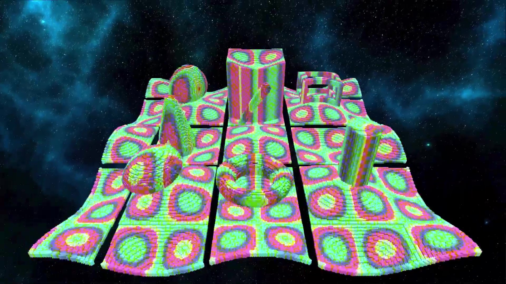</a>
    <a href='https://youtu.be/PWY0log0jAs?si=-28ExLPIA0ZSUU0I'>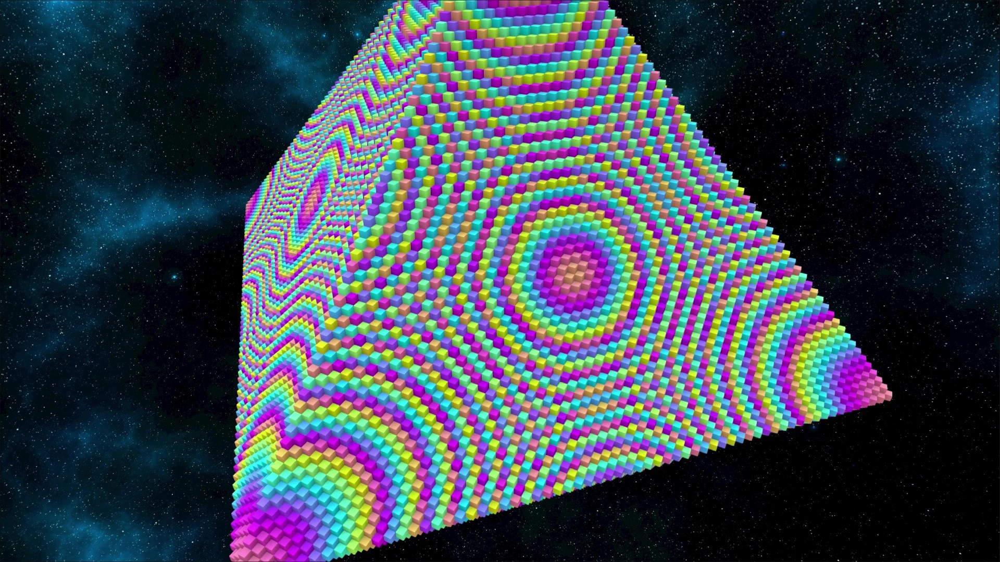</a>
    <a href='https://youtu.be/GVCD3PyIWWE?si=lNuKkuoXU-Ed_nkO'>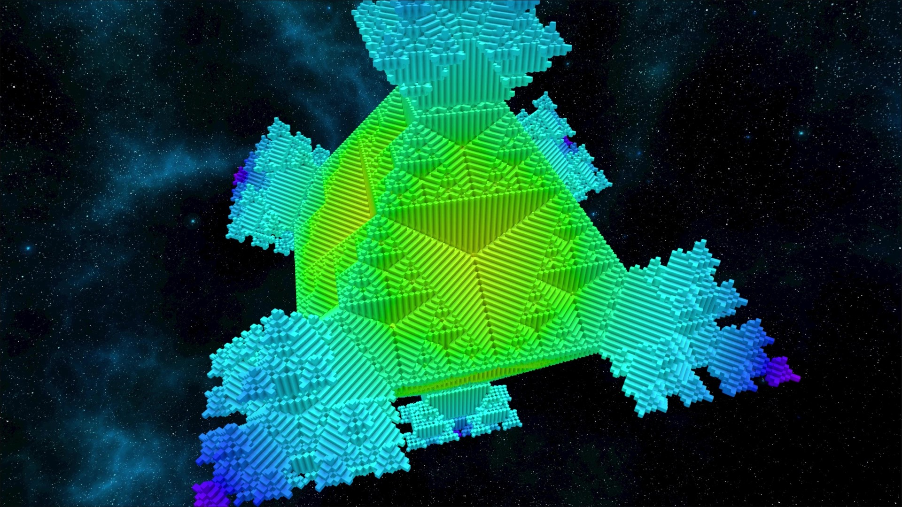</a>
</div>

## Application Examples

- **3D fractals**: We create 3D fractals that are a range of chaotic equation-based objects, most often derived from the Mandelbrot set. Typical examples include Mandelbulb, Menger sponge, Juliabulb, Sierpinski tetrahedron, etc. These 3D models are quickly created and rendered in 3D space using the GPU.
- **3D celluar automata**: We build 3D voxels, called 3D cellular automata that are a collection of cells arranged in three-dimensional space, where each cell changes its state as a function of time according to a defined set of rules.
- **Iterated function system**: We create 3D voxels from an iterated function system (IFS) which generates a 3D fractal by iterative equations (2D) or a set of transformations (3D).
- **SDF-based raymarch**: The SDF(signed-distance function) is used to define the shape and rendering properties of the 3D model, and the ray-march approach is used to generate the final 3D voxel models. By compositing multiple SDF models, more complex voxel models can be created.
- **3D tween**: We create a voxel model at one specific frame in the timeline. And, change that voxels at another specific frame. Animate then interpolates the intermediate models for the frames in between, creating the animation of one voxels morphing into another.

> NOTE: In v2.0 these GPU-side features run on WebGPU compute shaders written in
> three.js **TSL** — `gpu.js` is no longer used, and there is no extra dependency
> beyond `three`.

<div style='text-align: center'>
    <a href='https://opensea.io/assets/matic/0x2953399124f0cbb46d2cbacd8a89cf0599974963/90178724377835402463078005350460336323666865499173906711088353167566530674689'></a>
    <a href='https://opensea.io/assets/matic/0x2953399124f0cbb46d2cbacd8a89cf0599974963/90178724377835402463078005350460336323666865499173906711088353168666042302465'></a>
    <a href='https://opensea.io/assets/matic/0x2953399124f0cbb46d2cbacd8a89cf0599974963/90178724377835402463078005350460336323666865499173906711088353170865065558017'></a>
    <a href='https://opensea.io/assets/matic/0x2953399124f0cbb46d2cbacd8a89cf0599974963/90178724377835402463078005350460336323666865499173906711088353176362623696897'></a>
    <a href='https://opensea.io/assets/matic/0x2953399124f0cbb46d2cbacd8a89cf0599974963/90178724377835402463078005350460336323666865499173906711088353148874833002497'></a>
    <a href='https://opensea.io/assets/matic/0x2953399124f0cbb46d2cbacd8a89cf0599974963/90178724377835402463078005350460336323666865499173906711088353151073856258049'></a>
    <a href='https://opensea.io/assets/matic/0x2953399124f0cbb46d2cbacd8a89cf0599974963/90178724377835402463078005350460336323666865499173906711088353164267995791361'></a>
    <a href='https://opensea.io/assets/matic/0x2953399124f0cbb46d2cbacd8a89cf0599974963/90178724377835402463078005350460336323666865499173906711088353153272879513601'></a>
</div>

## Contact Us
Please contact us at info@nova-graphix.com for any questions or suggestions.
- Website: https://www.nova-graphix.com
- LinkedIn: https://www.linkedin.com/company/novagraphix/
- Facebook: https://www.facebook.com/NovaGraphixCo
- YouTube: https://www.youtube.com/@3D-novagraphix

## License
This project is licensed under the MIT License.